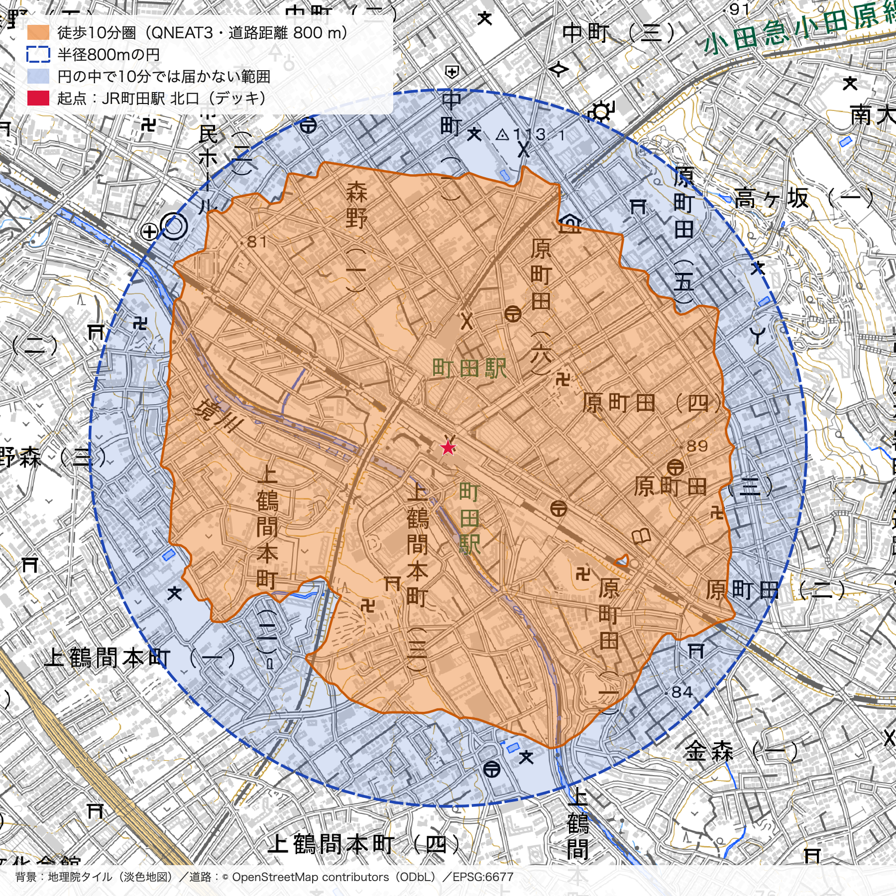
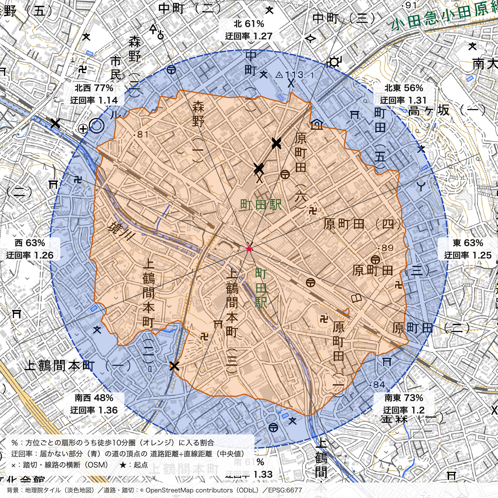

# QNEAT3 で町田駅の徒歩10分圏と半径800mの円を比べてみた

FOSS4G Hiroshima / SotM Asia OSAKA 振り返りハッカソン 2026 by MiaKozaki (FuruhashiLab)

## 成果物

🗺️ 比較マップ https://furuhashilab.github.io/Hackathon_Oct_MiaKozaki/



## 概要

FOSS4G Hiroshima 2026 の発表「GIS-Based Walking Map Isochrones in Measuring Transit Catchment: A Spatial Approach to Urban Accessibility」で紹介された **QNEAT3** を使い、「町田駅から徒歩10分で行ける範囲は、半径800mの円とどれくらい違うのか？」を調べた。

駅の徒歩圏は「半径800mの円」で表されることが多い。しかし実際には道に沿って歩くので、線路・川・踏切の配置によって、行ける範囲は円より狭く、いびつな形になるはずだと考えた。OSM の道路データから、JR町田駅北口を起点にした徒歩10分圏を QNEAT3 で計算し、円と重ねて比べた。

**結果：徒歩10分圏の面積は、半径800mの円の 62.8% だった。** 円の約4割は、道に沿って10分では行けない。届きにくいのは、線路や境川を **横切る** 方向（南西・北東）で、線路に **沿う** 方向（北西・南東）は届きやすかった。

## 使用技術

| 技術 | 用途 |
|---|---|
| QGIS 3.40.5 | 解析・地図作成の環境 |
| QuickOSM 2.5.4 | OSM の道路データ（highway）の取得 |
| **QNEAT3 1.0.8** | 道路ネットワークの到達圏（Iso-Area as Pointcloud / Interpolation） |
| GDAL（QGIS 同梱） | 到達コストのラスタから等高線ポリゴンを作成 |
| OpenStreetMap | 道路・踏切データ |
| 地理院タイル | 背景地図 |
| Leaflet.js | 比較 Web マップの作成 |
| GitHub Pages | 成果物の公開 |
| Claude Code (Opus 5.5) | 手順の案内、解析スクリプトの作成、結果の検証の支援 |

## 分析条件

| 項目 | 設定 |
|---|---|
| 起点 | JR町田駅 北口（デッキ・2階）　北緯35.542158° 東経139.445526°（JR東日本 町田駅構内図で確認、2026-10-12） |
| 道路データ | OSM highway、起点から半径2,000mの外接矩形（2026-10-12 21:17 取得、Overpass API） |
| 歩けない道の除外 | motorway など、`foot=no/private`、`access=no/private`（`foot=yes` などがある場合は残す） |
| 座標系 | JGD2011 / 平面直角座標系 第IX系（EPSG:6677） |
| 歩行速度 | 時速4.8km（毎分80m）で一定 → 10分 = 道路距離800m |
| QNEAT3 の設定 | Shortest（距離）、両方向、トポロジー許容値 0、セルサイズ 10m |
| 比較する円 | 起点から半径800m |
| 含めないもの | 信号待ち・坂・階段・混雑 |

起点は、OSM の歩行者デッキ（way [1085045748](https://www.openstreetmap.org/way/1085045748)：`highway=footway`、`bridge=yes`、`layer=1`、`opening_hours=24/7`）に接続された。下の地上の道には接続されていない。

## 結果

| 範囲 | 面積 | 円に対する比率 |
|---|---|---|
| 半径800mの円 | 2,009,812 m²（2.01 km²） | 100% |
| **徒歩10分圏（QNEAT3）** | **1,261,891 m²（1.26 km²）** | **62.8%** |
| 円には入るが10分では届かない範囲 | 747,921 m²（0.75 km²） | 37.2% |

### 方位ごとの比較

円を起点から8方位（45°ずつ）に分けて比べた。迂回率は、届かない部分にある道の「道路距離 ÷ 直線距離」の中央値。

| 方位 | 到達率 | 迂回率 |
|---|---|---|
| 北 | 61% | 1.27 |
| 北東 | 56% | 1.31 |
| 東 | 63% | 1.25 |
| 南東 | 73% | 1.20 |
| 南 | 61% | 1.33 |
| **南西** | **48%** | **1.36** |
| 西 | 63% | 1.26 |
| **北西** | **77%** | **1.14** |



## 考察

- **徒歩10分圏は、半径800mの円より4割近く狭い。** 円の端は直線距離で700m前後だが、道に沿うと850〜935m歩く必要がある。
- **線路や川を横切る方向で届きにくい。** 南西は、境川と線路の向こう側の上鶴間本町方面で、到達率が最も低かった（48%）。北東は、線路を踏切（OSM の「玉川学園前7号・8号」）で渡る必要がある方向だった。
- **線路に沿う方向は届きやすい。** 北西と南東は、JR線と平行な道が直線的に延びていて、迂回率が最も低かった（1.14・1.20）。


### 誤差・限界

- 速度を一定にしたので、坂（とくに北東の高ヶ坂方面）・信号・階段の影響は含まれていない。
- 到達圏ポリゴンは道の頂点から補間した面なので、内部のすべての地点に歩いて行けるとは限らない。
- OSM で `foot=no` になっている商店街の短い区間（パークアベニューなど）を除外している。この扱いは要確認。
- OSM に描かれていない通路（ビルの中の通り抜けなど）は含まれていない。

## ハマったところ

- **QNEAT3 の「Iso-Area as Polygons」が動かなかった。** QGIS 3.40 に同梱の matplotlib（3.3）が古く、`'QuadContourSet' object has no attribute 'get_paths'` というエラーになった。そこで、QNEAT3 の「Iso-Area as Interpolation」で到達コストのラスタを作り、GDAL の「等高線ポリゴン」で面にした。
- **補間の上限は1.1倍にする必要があった。** 上限を800mのままにすると、到達圏が四角く切れてしまった。QNEAT3 のソースを読むと、Polygons アルゴリズムは内部で上限を1.1倍にしてから補間していたので、それに合わせて880mにした。
- **スクリプトと手作業の結果を照合した。** QGIS の画面で同じ手順を手作業でも実行した。到達圏の面積は 1,261,891.38 m² で、スクリプトの結果と一致した（形のずれは 0.009 m²）。

## ファイル構成

```
├── index.html                  # 比較 Web マップ（GitHub Pages）
├── geojson/                    # Web マップ用のデータ（EPSG:4326）
├── README.md
├── LICENSE
├── docs/手順.md                 # 実行手順・設定条件の詳細
├── notes/観察メモ.md             # 届かない場所の観察・現地との比較
├── data/
│   ├── origin.gpkg             # 起点（自分で地図上に配置）
│   ├── osm_highway_20261012_2117.gpkg       # QuickOSM で取得した OSM 道路データ
│   └── osm_highway_20261012_2117_取得記録.md  # 取得日時・サーバー・Overpass クエリ
├── output/
│   ├── run_20261012_2124/      # スクリプトでの解析結果（到達圏・円・面積表・図）
│   │   └── gaps/               # 方位ごとの到達率・迂回率・踏切
│   └── gui_10min/              # QGIS の画面から手作業で実行した結果
├── logs/run_20261012_2124.json # 実行時の設定・バージョン・各処理の入出力
├── scripts/                    # 解析・作図スクリプト（qgis_process / PyQGIS）
├── tests/make_synthetic_osm.py # 動作確認用の合成ネットワーク
├── machida.qgz                 # 起点を置いた QGIS プロジェクト
└── result_run_20261012_2124.qgz  # 結果確認用の QGIS プロジェクト
```

再現する手順は [docs/手順.md](docs/手順.md) を参照。

## ライセンス

- 文章・図・スクリプト：Creative Commons Attribution 4.0 International（CC BY 4.0）
- OSM から作成したデータ（`data/osm_highway_*`、`output/` と `geojson/` の道路・踏切データ）：Open Database License（ODbL）

地図データ © OpenStreetMap contributors (ODbL)
背景地図：地理院タイル（国土地理院）

参考発表：Maisarah「GIS-Based Walking Map Isochrones in Measuring Transit Catchment: A Spatial Approach to Urban Accessibility」FOSS4G 2026（2026-09-01）https://talks.osgeo.org/foss4g-2026/talk/TZK3LW/
